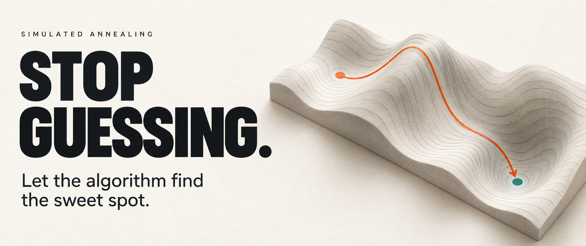

# Stop Guessing. Let the Algorithm Find the Sweet Spot.

A DEV.to article and executable evidence package about simulated annealing and measured configuration search.

[Public repository](https://github.com/copyleftdev/simulated-annealing-article) | [Download source ZIP](https://github.com/copyleftdev/simulated-annealing-article/archive/refs/heads/main.zip)



Start with [the article](article.md). The [editorial review](docs/editorial-review.md) records official DEV guidance and source checks. The [independent validation review](docs/validation-review.md) records executed verification and limitations.

## Reproduce the experiment

Requires a Rust toolchain with Cargo and Python 3. The Rust project has no external dependencies. The recorded run used Rust 1.99.0 and Python 3.14.4 on Linux; full environment details are in [results/environment.txt](results/environment.txt).

Clone the public repository, then run:

```sh
git clone https://github.com/copyleftdev/simulated-annealing-article.git
cd simulated-annealing-article
export CARGO_TARGET_DIR=target
cargo test --locked --offline
cargo run --release --locked --offline -- results/raw.csv
python3 scripts/verify.py --reproduce
python3 scripts/analyze.py
```

The local target directory avoids inherited Cargo settings pointing builds outside this project. The verification script rebuilds and runs the executable twice, checks scores independently, and compares all recorded fields except elapsed time. It also checks that the article's Rust excerpt matches the compiled implementation and that publication text contains no prohibited em dash characters.

Search results reproduce on the tested toolchain. Floating point transcendental functions can vary across platforms; identical random seeds do not guarantee bitwise equality on every platform. Search timing is expected to change between runs.

To refresh the plots, source excerpt, and article table:

```sh
python3 -m venv /tmp/annealing-figures
/tmp/annealing-figures/bin/python -m pip install -r requirements-plots.txt
/tmp/annealing-figures/bin/python scripts/analyze.py --plots --update-article
python3 scripts/verify.py
```

The analysis and verification scripts use only Python's standard library unless `--plots` is requested. Plot generation requires Matplotlib and NumPy. The dependency file pins the corresponding upstream releases; the included images used the distribution build Matplotlib 3.10.7+dfsg1 with NumPy 2.3.5. Existing results and images let readers inspect the experiment without installing plotting dependencies.

## What the experiment measures

The search space is a 64 by 64 grid with coordinates `-5.12 + 10.24 * index / 63`. The deterministic objective is `x*x + y*y + 20 - 10*cos(2*pi*x) - 10*cos(2*pi*y)`. Indices are abstract parameters, not service settings.

Every optimizer evaluates 256 candidates, including the initial point `(63, 63)`. Repeated points and invalid boundary proposals consume the same budget. Seeds are 1 through 30. Annealing uses a fixed geometric temperature schedule from 20 to 0.1 across 255 proposals. Both local methods propose a uniformly selected axis and signed displacement from 1 through 8. Out-of-range moves become self proposals.

Random search samples points uniformly with replacement after the shared initial evaluation. The fixed coarse grid samples 16 rounded levels per axis, evaluating the initial point first and avoiding a second evaluation of it. Its 30 CSV rows repeat a deterministic reference, not 30 independent experiments.

An exhaustive 4,096-call oracle is calculated separately and never feeds the optimizers. After each search selects its best training point, four objective calls evaluate offsets `(dx, dy)` from `{-0.1, +0.1}` squared. Their mean is the CSV's `held_out_score`: a deterministic shifted-objective sensitivity check. These four calls are additional to the search budget and outside the search timer.

The results support a limited but informative conclusion: annealing and greedy both found the discrete optimum in all 30 runs. Annealing has no demonstrated final-score advantage here. The local step range can jump across the objective's periodic hills. Random search and the fixed coarse grid give useful comparisons, but the ranking is specific to this objective, starting point, and budget.

The setup was chosen before inspecting the result and was not retuned to make annealing win. There is no measured service speedup, agent quality gain, infrastructure saving, or noisy-workload validation in this experiment.

## Artifacts

| Path | Purpose |
| --- | --- |
| `article.md` | DEV Markdown draft with metadata, citations, exact source excerpt, and measured table |
| `src/lib.rs` | Generic annealing kernel, experiment objective, baselines, and unit tests |
| `src/main.rs` | CSV-producing executable |
| `results/raw.csv` | All 120 search records |
| `results/summary.md` | Generated descriptive statistics |
| `results/summary.json` | Machine-readable statistics |
| `results/environment.txt` | Toolchain and machine context |
| `assets/*.png`, `assets/*.svg` | Figures generated from the experiment and its objective |
| `scripts/verify.py` | Independent Python calculation and reproduction checks |
| `scripts/analyze.py` | Summary, plot, and article block regeneration |
| `docs/editorial-review.md` | Sourced DEV publishing guidance and claim audit |
| `docs/validation-review.md` | Independent technical review |

The CSV fields include method, seed, objective-call count, selected indices, training score, shifted score, uphill acceptance count, search nanoseconds, oracle score, and gap to the oracle. `elapsed_ns` measures only search execution; it excludes oracle enumeration, shifted evaluation, CSV serialization, compilation, and plotting. Fixed method ordering and a very cheap objective make these timings unsuitable for performance ranking.

## Prepare for DEV publication

The article is hosted publicly on GitHub with `published: false` for DEV. No DEV post has been created. The article already uses public GitHub URLs for the companion project, cover, and figures.

1. Read and adapt the final draft in your own voice. Run the experiment and review the claims you intend to publish.
2. The companion project link points to this public repository. Readers can clone it or download the source ZIP linked above.
3. The `cover_image` value and both inline figures use public `raw.githubusercontent.com` URLs. In DEV's editor with separate title and cover fields, use that cover URL. Preserve the existing image alt text. The cover was generated with the built-in image tool; its complete prompt is in `assets/cover-prompt.txt`.
4. Use the title and four tags from the metadata. In DEV's basic editor, put them in the corresponding fields and paste the body without front matter. The title already supplies the page's H1.
5. Keep the authorship disclosure accurate and select the appropriate native disclosure tier. DEV's current definition includes primarily agent-generated text under Fully Autonomous; human review alone does not change that definition. The [editorial review](docs/editorial-review.md) links the official guidance.
6. Preview the draft in DEV, checking Rust syntax highlighting, tables, image descriptions, formulas, and public companion links before publishing.

The article source includes hidden comments delimiting generated blocks. They are safe to remove from a publication copy after regeneration. Do not manually edit the excerpt or result table without updating the source or evidence.
